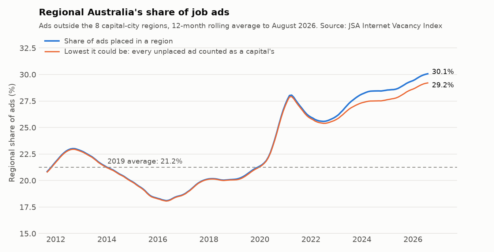
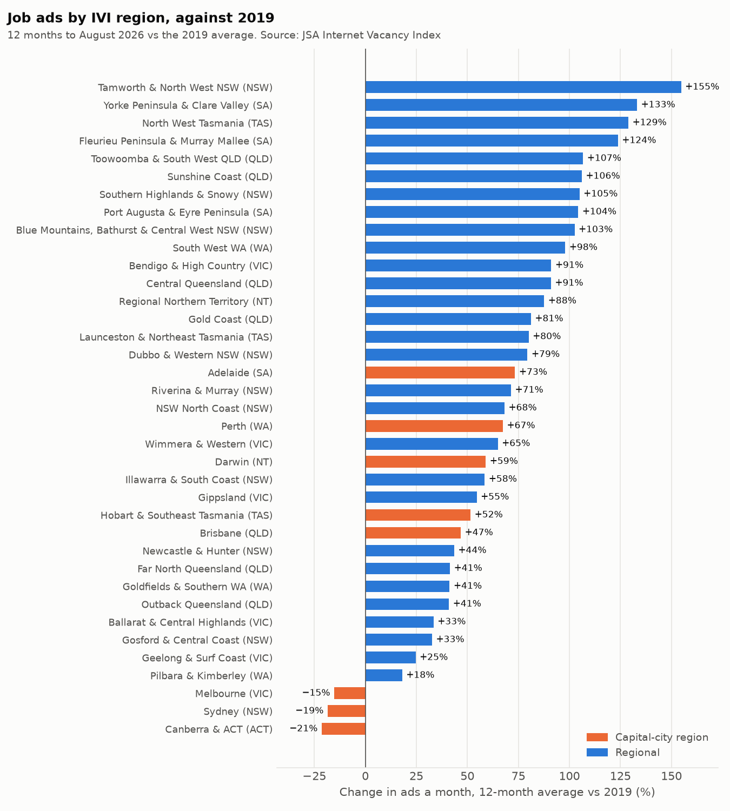
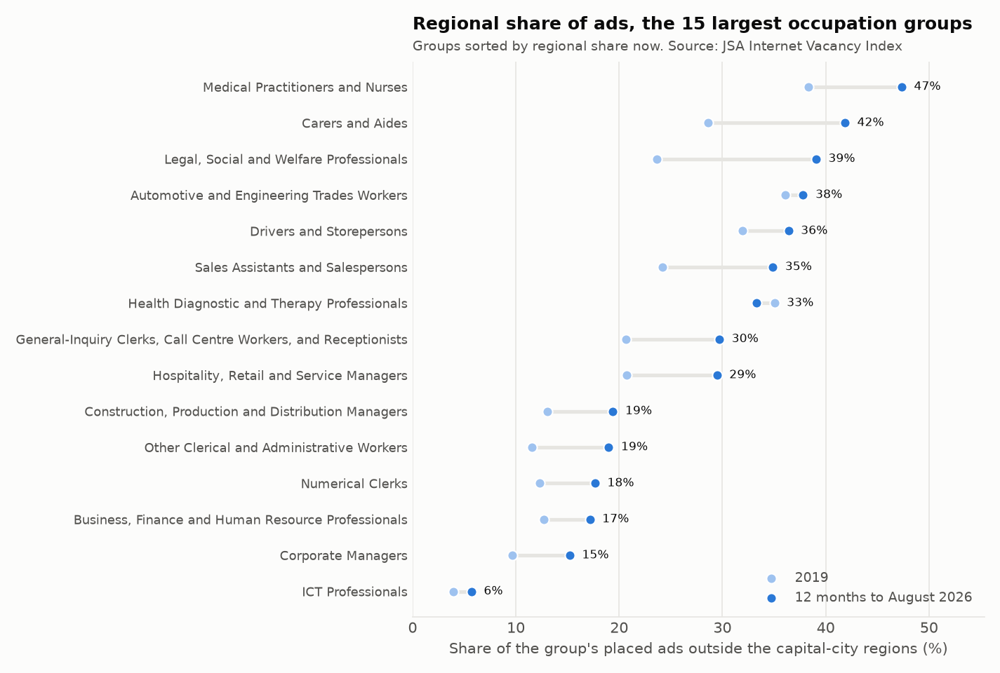
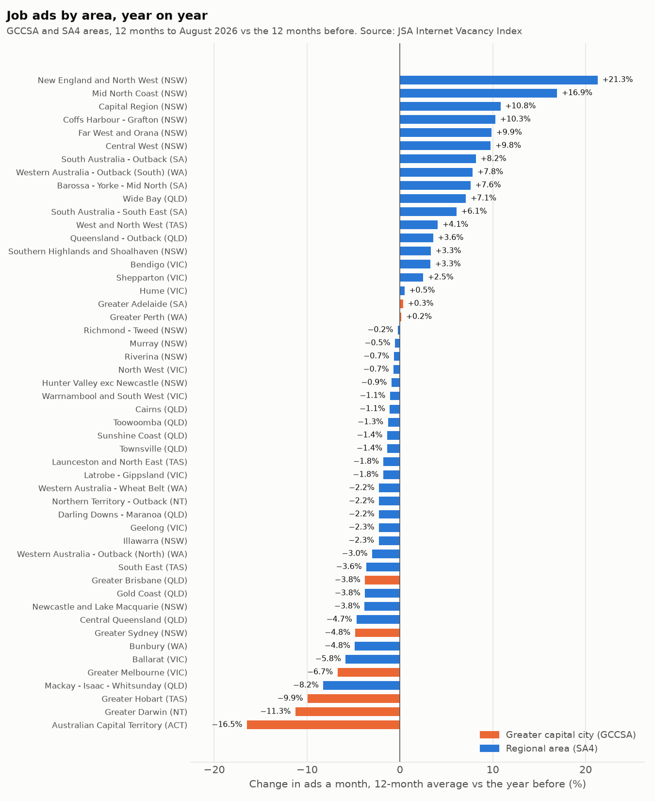

# Which jobs and regions are hiring in Australia? (skills-demand dashboard)

> **Status: in progress, Parts 1-3 of 5 done** (source profile, occupation demand, regional demand).
> Next: a Streamlit dashboard (Part 4), then CI and the final write-up (Part 5).

Recruiters, training providers and workforce planners all need the same answer: **which
occupations are employers advertising for, where, and is that demand rising or cooling?** A
training provider deciding which courses to run in Ballarat, or a recruitment agency deciding where
to open a desk, can't wait for the five-yearly Census.

Jobs and Skills Australia (JSA) publishes a monthly count of online job ads, the **Internet Vacancy
Index (IVI)**, by occupation, state and region, back to 2006. This project turns it into tested
tables, answers those questions, and ends with a dashboard a non-analyst can use.

It's easy to misread, though. Before ranking anything, Part 1 checks what the numbers mean.

## Data

| | |
|---|---|
| Dataset | [Internet Vacancy Index](https://www.jobsandskills.gov.au/data/internet-vacancy-index), August 2026 release (published 23 September 2026) |
| Publisher | Jobs and Skills Australia (Australian Government) |
| Licence | [CC BY 4.0](https://creativecommons.org/licenses/by/4.0/), per JSA's copyright page. © Commonwealth of Australia, Jobs and Skills Australia. |
| Files used | 4-digit ANZSCO occupations by state (Mar 2006 on); 2-digit occupation groups by 37 IVI regions (May 2010 on) and by GCCSA/SA4 area (Jan 2019 on); skill level by state, trend and seasonally adjusted (Jan 2006 on) |
| In this repo | `data/*.csv.gz`: the four workbooks melted to one row per series per month (1.5 million rows, about 9 MB). `data/SNAPSHOT.json` records the source and output SHA-256. |

No key or sign-up is needed. `scripts/download_data.py` tries jobsandskills.gov.au first. That site
drops scripted connections (it did from the machine this was built on), so each file falls back to
its Internet Archive copy, fetched byte for byte. The SHA-256 of every file is pinned, so a changed
file stops the run instead of quietly changing the results.

The IVI counts **online job ads** on SEEK, CareerOne and Workforce Australia, not vacancies or
hires. This README always says "job ads".

## Part 1: what the numbers mean

Full report: [`results/SOURCE_PROFILE.md`](results/SOURCE_PROFILE.md) (generated; every figure comes
from the snapshot).

**The snapshot matches JSA's own release.** The seasonally adjusted count rose by 559 ads (+0.3%) to
212,401 in August 2026; JSA's release says "increased by 0.3% (or 560 job advertisements) … to
stand at 212,400".

**Demand is cooling from a high level.** The 12 months to August 2026 averaged 209,655 ads a month,
−3.3% on the 12 months before but still 21.2% above 2019. It isn't a record: the seasonally adjusted
peak was 306,851 in April 2008, and August 2026 is 30.8% below it.


Six things would mislead a naive dashboard. Each one sets a rule for the rest of the project:

| Trap | What the data shows | Rule from here on |
|---|---|---|
| Occupation and regional data are raw 3-month averages, and they're seasonal | Against the seasonally adjusted level (2010-2019), the raw figure runs −10.9% in the 3 months ending January and +8.3% in those ending October | Compare the same month a year apart, or 12-month averages. Never month on month. |
| Adjusted series don't add up | In August 2026 the five seasonally adjusted skill levels sum to 212,839, against a total of 212,401 | Shares and mixes use raw 3-month averages only |
| 7 occupations are suppressed (no figures at all) | The published occupations miss 1.13% of ads in August 2026; the gap rose from 0.25% (2006) to 1.06% (2026 so far) | Shares use the published total, and say so. Totals are never rebuilt by adding occupations. |
| About 3% of ads aren't placed in any region | Regions held 99.7-99.9% of ads in 2011-2017 but 96.9% in August 2026. So regions grew 21.4% from 2019 against 24.8% nationally. About 3 points of that "regional lag" is coding, not demand. | Compare regions with each other, never with the national total. Keep the two regional geographies apart. |
| Most state × occupation cells are small, and small cells are noisy | 58% of the 2,808 cells have 20 or fewer ads a month. Year on year, 46% of cells with up to 5 ads moved by more than 50%, against 3% of cells with 20 to 50. | Growth rankings only include cells with more than 20 ads a month in the base period |
| Job ads aren't jobs | IVI misses word-of-mouth hiring and employer sites, counts a multi-position ad once, and leans towards higher-skilled roles | Results say "online job ads", a demand signal |

| | |
|---|---|
|  |  |

**So what for the business?** A dashboard built straight from these files would show an 18% "slump"
from October to January every year, credit regions with a lag that is really a coding change, and
top its "fastest growing" list with noise: unfiltered, the top 10 risers all started from 0.67 ads a
month or fewer, led by film and TV directors in South Australia (0.33 to 6.00 ads, +1700%). With the
20-ad floor, the top riser is midwives in Queensland (24.67 to 49.33 ads a month, +100%), a change
worth looking into. Part 1's rules remove all three problems before any ranking is shown.

## Part 2: which occupations are in demand

Full report: [`results/OCCUPATION_DEMAND.md`](results/OCCUPATION_DEMAND.md) (generated). Every
change is measured on 12-month averages (a full year, so the seasonal swing cancels) against the
year before and against 2019, plus the latest 3 months against the same 3 months a year earlier.
No growth rate is shown on a base of 20 ads a month or fewer.

**The fall has stopped, for now.** Ads averaged 209,655 a month in the 12 months to August 2026,
−3.3% on the year before. But the latest 3 months are +0.9% on a year earlier, and JSA's seasonally
adjusted August figure is +4.8% on August 2025.

**One occupation group grew.** Machinery operators and drivers is the only major group up on the
year (+6.6%) and the furthest above 2019 (+62.0%). Clerical and administrative workers are barely
above 2019 (+5.2%).


**Doctors and nurses cushioned the fall.** General practitioners and resident medical officers
added 1,362 ads a month (+36.4%); without them the fall would have been 8,413 a month, not 7,051.
Registered nurses (+397), electricians (+260) and nursing support workers (+236) came next. The
biggest falls were general clerks (−806), waiters (−534), child carers (−490) and software
programmers (−460).


**A demand matrix for the 108 occupations with 500+ ads a month** sorts each one by two questions:
up on the year, and above 2019?

| Demand state | Occupations | Ads a month | Largest |
|---|---|---|---|
| Growing, above 2019 | 32 | 51,472 | Registered Nurses, General Practitioners and Resident Medical Officers, Other Miscellaneous Labourers, Electricians |
| Cooling, still above 2019 | 52 | 86,868 | General Clerks, Sales Assistants (General), Retail Managers, Aged and Disabled Carers |
| Rising, still below 2019 | 2 | 4,238 | Construction Managers, Financial Investment Advisers and Managers |
| Shrinking, below 2019 | 22 | 31,307 | Advertising and Sales Managers, Accountants, Software and Applications Programmers, Human Resource Professionals |


**States split sharply.** SA is +82.5% on 2019; VIC (−4.1%) and ACT (−21.4%) are below it, and ACT
fell most on the year (−15.8%). Machinery operators and drivers rose in 6 of the 8 states, most of
all in SA (+18%) and WA (+14%).


**So what for the business?**

- **Recruiters:** the strongest big markets include registered nurses (6,883 ads a month, +6.1%), GPs
  (5,105, +36.4%), electricians (3,064, +9.3%) and truck drivers (2,807, +2.0%). General clerks,
  waiters and child carers are losing the most ads, so placement volumes there are most at risk.
- **Training providers:** health, care and electrical courses feed occupations that are all above
  2019, though child carers (−12.9%) and aged and disabled carers (−3.1%) are cooling. ICT courses
  face a market far below 2019: software programmers −46.6%, ICT business and systems analysts
  −41.0%.
- **Workforce planners:** 22 big occupations are below 2019 and still falling, the largest being
  advertising and sales managers, accountants and software programmers. Don't plan on them
  bouncing back to 2019 levels.
- **A caution:** 5 occupations with 100+ ads a month are at least 3 times their 2019 level (GPs
  4.8×, vets 5.1×). Some are real shortages, but a jump that big could also be a change in how ads
  are coded. Check the monthly series before acting on one.

## Part 3: where the ads are

Full report: [`results/REGIONAL_DEMAND.md`](results/REGIONAL_DEMAND.md) (generated). It follows Part
1's rules for regions: regions are compared with each other, never with the national total; the 37
IVI regions (from October 2010) carry the comparison with 2019; the GCCSA/SA4 areas are used year
on year only. "Capital-city regions" are the 8 IVI regions that contain a capital.

**A shift to regional Australia, and it's still going.** The 29 regional areas averaged 61,229 ads
a month in the 12 months to August 2026, +67.1% on 2019, against +4.9% for the capital-city regions.
Regional Australia now holds 30.1% of placed ads, up from 21.2% in 2019. Over the last year the
capitals lost 7,253 ads a month (−4.8%) while regional areas gained 362 (+0.6%).

**It isn't a coding effect.** On average 6,013 ads a month aren't placed in any region. Even if every one
belonged to a capital, the regional share would be 29.2%, so unplaced ads can explain at most 0.8 of
the 8.8 points of shift. The share jumped in 2020, fell back to 25.6% in July 2022, then rose in 48
of the 49 months since.



**Only three regions are below 2019, and all are capitals:** Canberra & ACT (−21.4%), Sydney
(−18.5%) and Melbourne (−15.3%). Every one of the 29 regional areas is above 2019, from Pilbara &
Kimberley (+18.0%) to Tamworth and North West NSW (+154.7%).



**Health and care lead the move.** 47.3% of ads for medical practitioners and nurses are now
regional (38.3% in 2019). Regional ads for them rose +27.4% on the year while the capitals' were
flat (−0.2%): regional areas added 1,191 a month and the capitals lost 11. So the doctor and nurse
growth in Part 2 is a regional story. Carers and aides (41.8% regional, from 28.6%) and legal,
social and welfare professionals (39.1%, from 23.6%; +13.6% in the regions on the year, −8.8% in
the capitals) moved the same way. ICT professional ads stay in the capitals: only 5.7% are regional.



**The year-on-year view agrees.** In the GCCSA/SA4 file the 8 greater capital cities are −4.6% on
the year and the 42 regional SA4s +0.4%. Regional NSW leads: 6 of the 10 fastest-growing SA4s are
in NSW, topped by New England and North West (+21.3%). The two geographies give the same direction
for all 8 capitals, at most 0.9 points apart.



**So what for the business?**

- **Recruiters:** 3 in 10 placed ads are now outside the capitals, and that part of the market held
  up while the capitals fell. A desk that only covers the capitals is working the shrinking part.
  The fastest-growing big regional markets: Tamworth and North West NSW (+23.3%), Dubbo & Western
  NSW (+12.5%) and NSW North Coast (+8.5%).
- **Training providers:** health and care courses have a case for regional campuses or clinical
  placements. On the NSW North Coast, for example, medical practitioners and nurses have 541 ads a
  month, 2.7× as common as across all regions, and +62.0% on the year. ICT courses are a capital-city
  market.
- **Employers and workforce planners:** Canberra, Sydney and Melbourne have fewer ads than in 2019,
  so employers there compete with fewer other ads for staff. Every regional area has more ads than
  in 2019, so a regional employer should plan for more competition for the same local workers.
- **A caution:** single jumps can come from a few large employers. Tamworth's ads for medical
  practitioners and nurses went from 120 to 350 a month in a year; check the monthly series before
  acting on one. Use region figures to rank and compare places, not as exact counts.

## How to run

```bash
python -m venv .venv && source .venv/bin/activate
pip install -r requirements.txt

python -m scripts.download_data     # optional: fetches the 4 workbooks (12 MB) into data/raw/
python -m scripts.build_snapshot    # optional: rebuilds data/*.csv.gz from them
python -m scripts.profile_source    # Part 1 report and charts, from the committed snapshot
python -m scripts.occupation_demand # Part 2 report, charts and CSVs
python -m scripts.regional_demand   # Part 3 report, charts and CSVs
pytest
```

The committed snapshot is enough to rerun every report; the download is only needed to rebuild it.

## Project layout

```
scripts/download_data.py    fetch the workbooks (official site first, archive fallback, pinned SHA-256)
scripts/build_snapshot.py   workbooks -> tidy data/*.csv.gz + SNAPSHOT.json
scripts/profile_source.py   Part 1 report: results/SOURCE_PROFILE.md, charts 01-04, CSVs
scripts/occupation_demand.py  Part 2 report: results/OCCUPATION_DEMAND.md, charts 05-08, CSVs
scripts/regional_demand.py  Part 3 report: results/REGIONAL_DEMAND.md, charts 09-12, CSVs
ivi/load.py                 load the snapshot with the right types (codes stay text)
ivi/profile.py              the Part 1 checks, as small testable functions
ivi/demand.py               the Part 2 measures (12-month averages, the 20-ad floor, demand matrix)
ivi/regions.py              the Part 3 measures (capital vs regional, location quotient, SA4 year on year)
tests/                      unit tests on hand-made data + checks on the committed snapshot
```

## Data credit

Contains data from the Jobs and Skills Australia Internet Vacancy Index, © Commonwealth of
Australia, licensed under CC BY 4.0. The figures here are my own analysis of that data, not JSA's.
