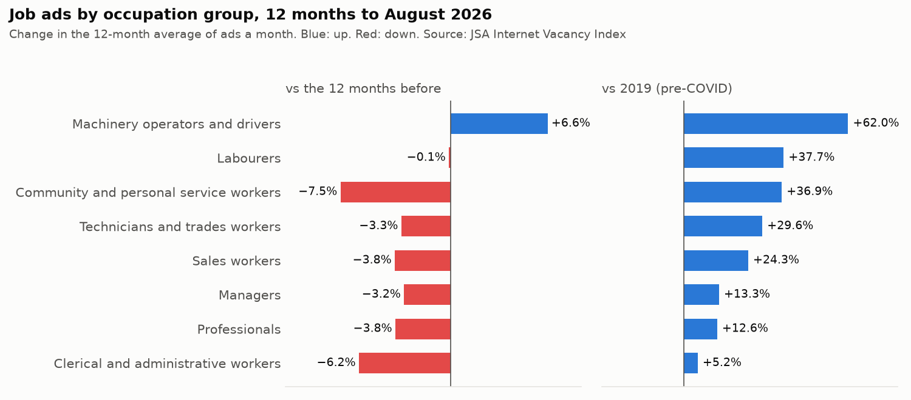
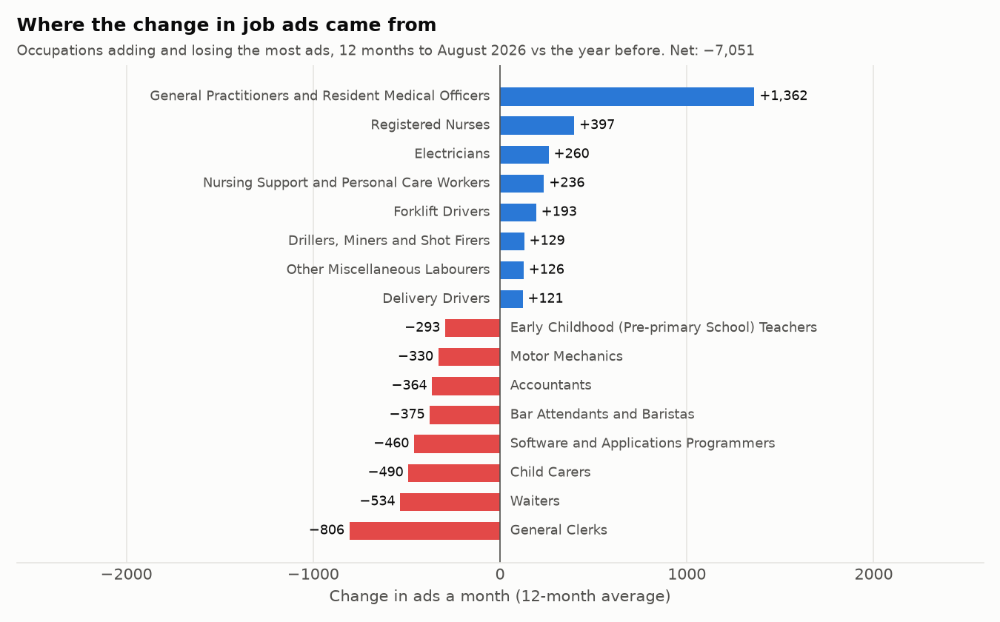
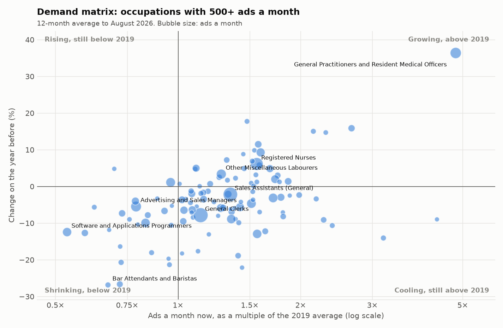
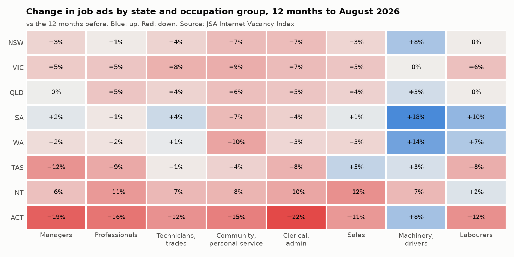

# Part 2: occupation demand

_Generated by `scripts/occupation_demand.py` from the snapshot in `data/`. Do not edit by hand._

How every number here is measured (the rules come from Part 1, `SOURCE_PROFILE.md`):

- **12-month average:** the mean of the 12 monthly 3-month averages ending August 2026. A full year, so the seasonal swing cancels. "vs year before" compares it with the 12 months ending August 2025; "vs 2019" with the calendar-2019 average (pre-COVID).
- **Latest 3 months vs a year earlier:** the 3-month average to August 2026 against the one to August 2025. The same 3 calendar months, so no seasonal bias; it shows whether the 12-month trend is still going or turning.
- **Floor:** a growth rate is only shown when its base averages more than 20 ads a month ("–" otherwise).
- **Shares** use the published total, which includes the 7 suppressed occupations. Major groups are built from the published 4-digit occupations, so Managers, Professionals and Community and personal service workers are slightly understated (the suppressed ones belong to those groups).

## The whole market

Australia averaged 209,655 ads a month in the 12 months to August 2026, −3.3% on the year before and +21.2% on 2019. But the latest 3 months are +0.9% on the same 3 months a year earlier, and JSA's seasonally adjusted August 2026 figure is +4.8% on August 2025. **The 12-month average is still falling, but the year-on-year fall has stopped**, for now.

| State | Ads a month (12-mo avg) | vs year before | Latest 3 months vs a year earlier | vs 2019 |
|---|---|---|---|---|
| Australia | 209,655 | −3.3% | +0.9% | +21.2% |
| NSW | 62,458 | −2.0% | +0.1% | +1.8% |
| VIC | 45,237 | −5.8% | +0.5% | −4.1% |
| QLD | 50,544 | −3.4% | −0.3% | +61.0% |
| SA | 14,055 | +1.1% | +2.9% | +82.5% |
| WA | 26,692 | −0.2% | +6.9% | +66.2% |
| TAS | 3,313 | −5.3% | −1.1% | +79.8% |
| NT | 2,835 | −8.4% | −8.9% | +67.4% |
| ACT | 4,521 | −15.8% | −4.2% | −21.4% |

States split sharply. SA is furthest above 2019 (+82.5%); VIC (−4.1%) and ACT (−21.4%) are below it, and ACT fell most on the year (−15.8%). State totals come straight from JSA (they add up; Part 1, trap 2).

## By major occupation group

| Major group | Ads a month (12-mo avg) | Share of all ads | vs year before | Latest 3 months vs a year earlier | vs 2019 |
|---|---|---|---|---|---|
| Machinery operators and drivers | 13,006 | 6.2% | +6.6% | +12.6% | +62.0% |
| Labourers | 13,874 | 6.6% | −0.1% | +2.3% | +37.7% |
| Community and personal service workers | 20,131 | 9.6% | −7.5% | −1.9% | +36.9% |
| Technicians and trades workers | 29,855 | 14.2% | −3.3% | +3.4% | +29.6% |
| Sales workers | 16,334 | 7.8% | −3.8% | −1.2% | +24.3% |
| Managers | 25,010 | 11.9% | −3.2% | +2.4% | +13.3% |
| Professionals | 58,537 | 27.9% | −3.8% | +0.2% | +12.6% |
| Clerical and administrative workers | 30,823 | 14.7% | −6.2% | −4.7% | +5.2% |

Machinery operators and drivers is the only group up on the year (+6.6%) and the furthest above 2019 (+62.0%). Community and personal service workers fell most (−7.5%). Clerical and administrative workers are the least above 2019 (+5.2%).

## Where the change came from

All ads fell by 7,051 a month on the year (12-month averages). The published occupations fell by 7,659, so the suppressed occupations and rounding added 607. 125 occupations added ads and 226 lost them. The biggest single move was General Practitioners and Resident Medical Officers: +1,362 ads a month (+36.4%). Without it the fall would have been 8,413 a month, not 7,051. The biggest fall was General Clerks (−806).

| Occupation | Year before | 12 months to August 2026 | Change (ads a month) |
|---|---|---|---|
| General Practitioners and Resident Medical Officers | 3,743 | 5,105 | +1,362 |
| Registered Nurses | 6,486 | 6,883 | +397 |
| Electricians | 2,804 | 3,064 | +260 |
| Nursing Support and Personal Care Workers | 1,484 | 1,720 | +236 |
| Forklift Drivers | 1,685 | 1,878 | +193 |
| Drillers, Miners and Shot Firers | 730 | 859 | +129 |
| Other Miscellaneous Labourers | 3,753 | 3,879 | +126 |
| Delivery Drivers | 805 | 926 | +121 |
| Storepersons | 2,141 | 2,245 | +104 |
| Architectural, Building and Surveying Technicians | 2,009 | 2,109 | +100 |
| General Clerks | 10,294 | 9,488 | −806 |
| Waiters | 2,006 | 1,471 | −534 |
| Child Carers | 3,789 | 3,299 | −490 |
| Software and Applications Programmers | 3,695 | 3,236 | −460 |
| Bar Attendants and Baristas | 1,397 | 1,022 | −375 |
| Accountants | 3,660 | 3,296 | −364 |
| Motor Mechanics | 3,713 | 3,383 | −330 |
| Early Childhood (Pre-primary School) Teachers | 1,554 | 1,261 | −293 |
| Cooks | 1,346 | 1,068 | −279 |
| Advertising and Sales Managers | 4,838 | 4,574 | −265 |

## The 15 largest occupations

| Occupation | Ads a month (12-mo avg) | Year before | vs year before | Latest 3 months vs a year earlier | vs 2019 |
|---|---|---|---|---|---|
| General Clerks | 9,488 | 10,294 | −7.8% | −9.4% | +13.5% |
| Sales Assistants (General) | 8,866 | 9,063 | −2.2% | +2.5% | +34.3% |
| Registered Nurses | 6,883 | 6,486 | +6.1% | +16.1% | +56.0% |
| General Practitioners and Resident Medical Officers | 5,105 | 3,743 | +36.4% | +25.7% | +380.3% |
| Advertising and Sales Managers | 4,574 | 4,838 | −5.5% | −3.6% | −21.2% |
| Other Miscellaneous Labourers | 3,879 | 3,753 | +3.4% | +1.2% | +27.6% |
| Construction Managers | 3,636 | 3,596 | +1.1% | +11.7% | −4.2% |
| Retail Managers | 3,558 | 3,732 | −4.7% | −1.8% | +51.3% |
| Aged and Disabled Carers | 3,522 | 3,636 | −3.1% | +0.7% | +71.1% |
| Motor Mechanics | 3,383 | 3,713 | −8.9% | −5.9% | +35.1% |
| Child Carers | 3,299 | 3,789 | −12.9% | −19.7% | +56.3% |
| Accountants | 3,296 | 3,660 | −9.9% | −6.8% | −16.9% |
| Software and Applications Programmers | 3,236 | 3,695 | −12.4% | −19.3% | −46.6% |
| Electricians | 3,064 | 2,804 | +9.3% | +18.5% | +59.4% |
| Chefs | 2,913 | 3,087 | −5.7% | +8.9% | +41.9% |

## Fastest rising and falling (of 318 occupations with more than 20 ads a month a year earlier)

### Rising

| Occupation | Ads a month (12-mo avg) | Year before | vs year before | Latest 3 months vs a year earlier | vs 2019 |
|---|---|---|---|---|---|
| Train and Tram Drivers | 79.6 | 47.1 | +69.0% | +85.2% | +199.6% |
| Geologists and Geophysicists | 204 | 149 | +36.5% | +32.2% | +47.8% |
| General Practitioners and Resident Medical Officers | 5,105 | 3,743 | +36.4% | +25.7% | +380.3% |
| Agricultural, Forestry and Horticultural Plant Operators | 74.4 | 58.2 | +27.7% | +54.7% | +91.8% |
| Roof Tilers | 107 | 83.9 | +27.3% | +25.3% | +79.9% |
| Optometrists and Orthoptists | 87.3 | 68.6 | +27.2% | +35.5% | +131.7% |
| Surgeons | 62.2 | 49.3 | +26.2% | +106.8% | +135.7% |
| Travel Attendants | 25.1 | 20.2 | +24.2% | −7.1% | – |
| Livestock Farm Workers | 118 | 95.9 | +22.8% | +36.0% | +143.0% |
| Education Advisers and Reviewers | 54.0 | 44.7 | +20.9% | +3.0% | +32.6% |

### Falling

| Occupation | Ads a month (12-mo avg) | Year before | vs year before | Latest 3 months vs a year earlier | vs 2019 |
|---|---|---|---|---|---|
| Music Professionals | 25.4 | 45.6 | −44.2% | −70.3% | – |
| Checkout Operators and Office Cashiers | 92.0 | 160 | −42.5% | −20.1% | +53.4% |
| Shelf Fillers | 86.6 | 135 | −35.8% | −36.3% | +188.3% |
| Domestic Cleaners | 37.1 | 56.5 | −34.3% | −2.7% | +35.2% |
| Primary Products Inspectors | 17.5 | 25.4 | −30.9% | – | – |
| Chiropractors and Osteopaths | 14.8 | 20.6 | −28.3% | – | – |
| Bar Attendants and Baristas | 1,022 | 1,397 | −26.8% | +11.5% | −32.8% |
| Waiters | 1,471 | 2,006 | −26.6% | +16.2% | −28.1% |
| Land Economists and Valuers | 103 | 138 | −25.2% | −32.0% | +26.0% |
| Keyboard Operators | 129 | 169 | −23.8% | −28.3% | −46.8% |

## Demand matrix (108 occupations with 500+ ads a month)

Each occupation is placed by two questions: is it up on the year, and is it above 2019? The four answers call for different actions.

| Demand state | Occupations | Ads a month | Largest |
|---|---|---|---|
| Growing, above 2019 | 32 | 51,472 | Registered Nurses, General Practitioners and Resident Medical Officers, Other Miscellaneous Labourers, Electricians |
| Cooling, still above 2019 | 52 | 86,868 | General Clerks, Sales Assistants (General), Retail Managers, Aged and Disabled Carers |
| Rising, still below 2019 | 2 | 4,238 | Construction Managers, Financial Investment Advisers and Managers |
| Shrinking, below 2019 | 22 | 31,307 | Advertising and Sales Managers, Accountants, Software and Applications Programmers, Human Resource Professionals |

In 31 of these 108 occupations the latest 3 months move against the 12-month trend (down on the year but up on the same months a year earlier, or the reverse). The largest: Sales Assistants (General) (−2.2% on the year, +2.5% in the latest 3 months); Aged and Disabled Carers (−3.1% on the year, +0.7% in the latest 3 months); Chefs (−5.7% on the year, +8.9% in the latest 3 months); Metal Fitters and Machinists (−5.9% on the year, +3.1% in the latest 3 months); Human Resource Professionals (−4.0% on the year, +2.6% in the latest 3 months).

**Read multi-fold rises with care.** 5 occupations with 100+ ads a month are at least 3 times their 2019 level (largest first): General Practitioners and Resident Medical Officers (4.8×), Audiologists and Speech Pathologists/Therapists (3.2×), Primary School Teachers (4.3×), Veterinarians (5.1×), Veterinary Nurses (5.2×). Some will be real shortages, but a step that big can also come from a change in how ads are coded to occupations, which this data can't rule out. Check the monthly series before acting on one.

## By state

Change in each state's major groups on the year before (12-month averages):

Largest and fastest-rising occupations in each state (12-month averages; risers need more than 20 ads a month a year earlier, so small-cell noise can't top the list):

| State | Largest (ads a month) | Fastest rising (base above 20) |
|---|---|---|
| NSW | Sales Assistants (General) (2,620); General Practitioners and Resident Medical Officers (2,453); General Clerks (2,420) | General Practitioners and Resident Medical Officers (1,491 to 2,453, +65%); Other Medical Practitioners (71.4 to 115, +60%); Electrical Distribution Trades Workers (31.2 to 43.3, +39%) |
| VIC | General Clerks (2,045); Sales Assistants (General) (1,923); Registered Nurses (1,616) | Retail Supervisors (27.3 to 35.2, +29%); Other Stationary Plant Operators (47.3 to 59.1, +25%); Actors, Dancers and Other Entertainers (49.1 to 58.7, +20%) |
| QLD | General Clerks (2,460); Sales Assistants (General) (2,268); Registered Nurses (1,422) | Primary School Teachers (116 to 174, +50%); Midwives (25.7 to 35.3, +37%); Authors, and Book and Script Editors (20.6 to 27.4, +33%) |
| SA | Registered Nurses (736); General Clerks (721); Sales Assistants (General) (599) | Corporate Services Managers (35.1 to 49.7, +42%); Other Stationary Plant Operators (26.4 to 36.8, +39%); Mining Engineers (28.0 to 38.1, +36%) |
| WA | General Clerks (1,265); Sales Assistants (General) (1,011); Metal Fitters and Machinists (792) | Geologists and Geophysicists (95.1 to 143, +50%); Greenkeepers (20.4 to 28.4, +39%); Science Technicians (30.8 to 42.5, +38%) |
| TAS | Sales Assistants (General) (178); Registered Nurses (166); General Clerks (164) | Nursing Support and Personal Care Workers (26.7 to 56.2, +111%); Accountants (23.6 to 28.5, +21%); General Practitioners and Resident Medical Officers (118 to 140, +18%) |
| NT | General Clerks (172); Registered Nurses (132); Sales Assistants (General) (92.2) | General Practitioners and Resident Medical Officers (54.4 to 66.0, +21%); Construction Managers (49.0 to 56.8, +16%); Welfare Support Workers (45.7 to 50.7, +11%) |
| ACT | Software and Applications Programmers (256); General Clerks (241); Sales Assistants (General) (174) | Civil Engineering Professionals (31.7 to 38.4, +21%); Truck Drivers (31.3 to 35.2, +12%); Nursing Support and Personal Care Workers (22.3 to 25.0, +12%) |

## By skill level

JSA publishes skill levels only as seasonally adjusted and trend series, and those don't add up (Part 1, trap 2), so each level is compared only with itself. No shares.

| Skill level | August 2026 (SA) | 12-mo avg vs year before | August 2026 vs August 2025 | 12-mo avg vs 2019 |
|---|---|---|---|---|
| Skill level 1 (bachelor degree or higher) | 77,323 | −1.8% | +5.6% | +13.6% |
| Skill level 2 (advanced diploma or diploma) | 24,711 | −3.5% | +4.7% | +21.6% |
| Skill level 3 (Certificate IV, or III with on-the-job training) | 32,626 | −4.7% | +1.9% | +32.7% |
| Skill level 4 (Certificate II or III) | 53,408 | −2.0% | +3.9% | +24.8% |
| Skill level 5 (Certificate I or secondary school) | 24,772 | −0.2% | +8.8% | +38.9% |

Every level is above 2019; skill level 5 is furthest above (+38.9%) and skill level 1 least (+13.6%). In August 2026 all five are above August 2025.

## So what for the business?

- **Recruiters:** the strongest markets are the big occupations still growing and above 2019: Registered Nurses (6,883 a month, +6.1%), General Practitioners and Resident Medical Officers (5,105 a month, +36.4%), Other Miscellaneous Labourers (3,879 a month, +3.4%), Electricians (3,064 a month, +9.3%), Truck Drivers (2,807 a month, +2.0%). The big occupations losing the most ads, where placement volumes are most at risk: General Clerks (−806 a month, −7.8%), Waiters (−534 a month, −26.6%), Child Carers (−490 a month, −12.9%).
- **Training providers:** health, care and electrical courses feed occupations that are all above 2019, though not all still growing: Registered Nurses (growing, above 2019, +6.1% on the year); Nursing Support and Personal Care Workers (growing, above 2019, +15.9% on the year); Aged and Disabled Carers (cooling, still above 2019, −3.1% on the year); Electricians (growing, above 2019, +9.3% on the year); Child Carers (cooling, still above 2019, −12.9% on the year). ICT courses face a market well below 2019: Software and Applications Programmers −46.6%, ICT Business and Systems Analysts −41.0%, ICT Support and Test Engineers −43.4%, Multimedia Specialists and Web Developers −67.4%.
- **Workforce planners:** 22 big occupations are below 2019 and still falling, the largest being Advertising and Sales Managers, Accountants, Software and Applications Programmers. A plan that assumes these will bounce back to 2019 levels isn't supported by the data so far.
- **Everyone:** the national 12-month average still says "cooling", but the latest 3 months are up on a year earlier. Check the same-month comparison in each new release before planning cuts.
