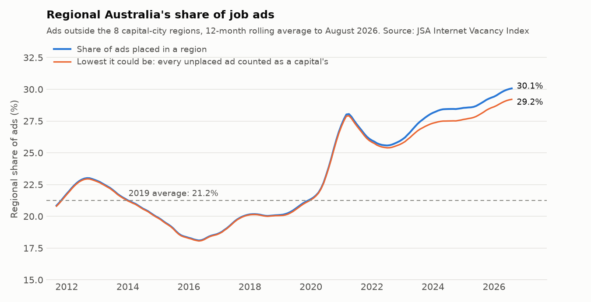
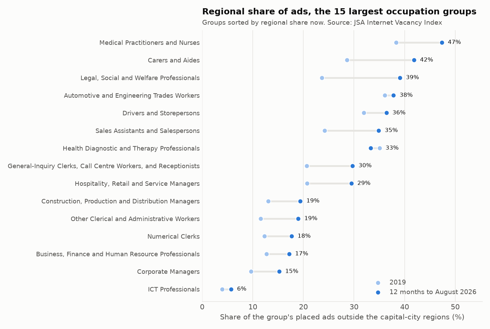
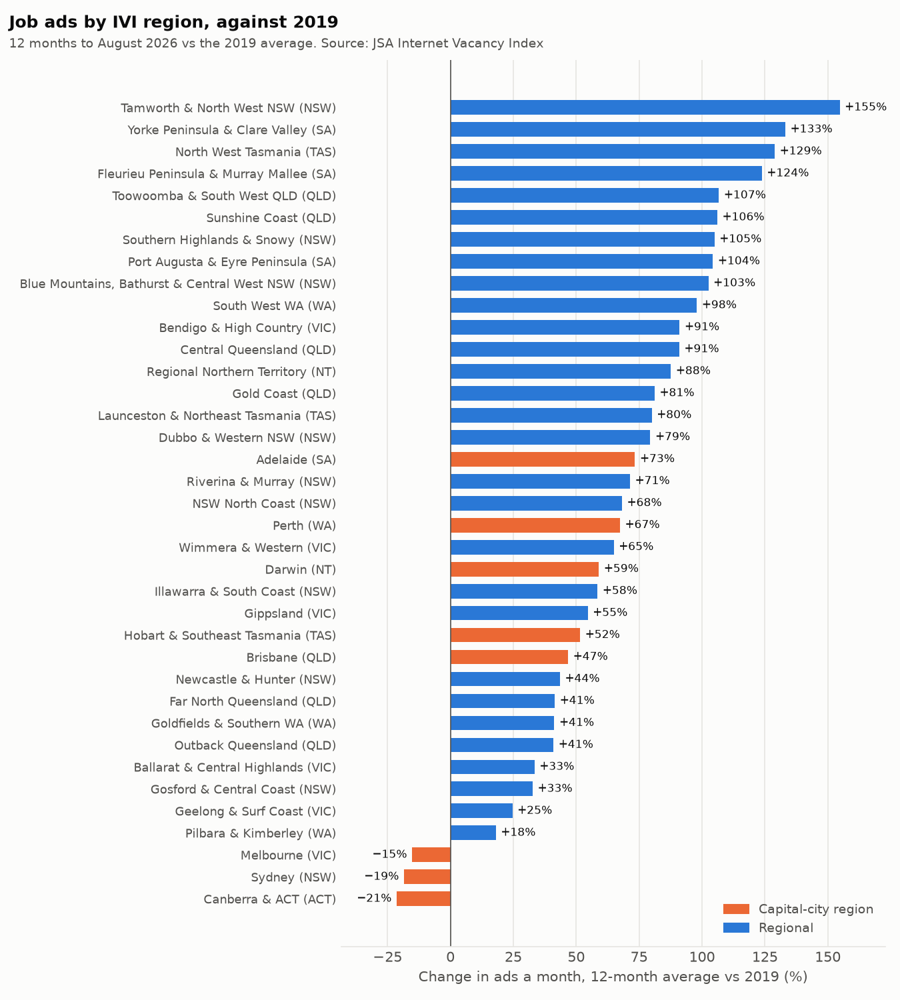
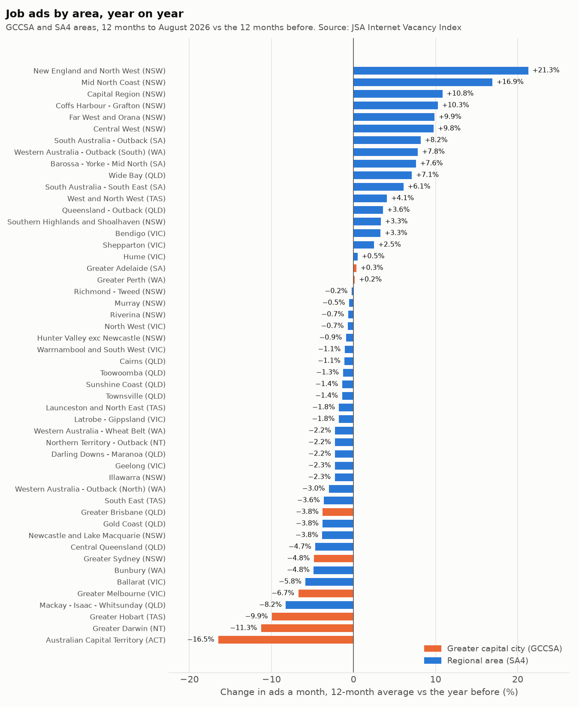

# Part 3: regional demand

_Generated by `scripts/regional_demand.py` from the snapshot in `data/`. Do not edit by hand._

How every number here is measured (the rules come from Part 1, `SOURCE_PROFILE.md`, trap 4):

- **Two geographies, kept apart.** The 37 **IVI regions** (JSA's best-fit labour markets) are used from October 2010, the first month they hold 99% of national ads, and carry the 2019 comparison. The 50 **GCCSA/SA4 areas** (8 greater capital cities, 42 regional SA4s) were backcast to 2019 and are rough there, so they are used **year on year only**.
- **Regions are compared with regions.** About 3% of ads are coded to a state but to no region, so a region is never compared with the national or state total. Shares are shares of ads placed in a region.
- **Capital-city regions** are the 8 IVI regions containing a capital: Sydney (NSW), Melbourne (VIC), Brisbane (QLD), Adelaide (SA), Perth (WA), Hobart & Southeast Tasmania (TAS), Darwin (NT), Canberra & ACT (ACT). IVI regions aren't the ABS capital-city boundaries: Hobart's region takes in the south-east, and Canberra's is the whole territory. The other 29 regions are "regional".
- **12-month averages** to August 2026 vs the 12 months before and vs calendar 2019; the latest 3 months vs the same 3 months a year earlier; no growth rate on a base of 20 ads a month or fewer (Part 2's method).

## Capital cities vs regional Australia

|  | Ads a month (12-mo avg) | vs year before | Change (ads a month) | Latest 3 months vs a year earlier | vs 2019 | Share of placed ads | Share in 2019 |
|---|---|---|---|---|---|---|---|
| 8 capital-city regions | 142,413 | −4.8% | −7,253 | −0.3% | +4.9% | 69.9% | 78.8% |
| 29 regional areas | 61,229 | +0.6% | +362 | +2.5% | +67.1% | 30.1% | 21.2% |

Regional ads are +67.1% on 2019, against +4.9% for the capital-city regions. Over the last year the capitals lost 7,253 ads a month (−4.8%) while regional areas gained 362 (+0.6%). **Regional Australia now holds 30.1% of placed ads, up from 21.2% in 2019.**

**Is that a coding effect?** Part 1 found that the share of ads placed in any region fell after 2019. If every unplaced ad belonged to a capital, the regional share would still be 29.2%, against 21.2% in 2019 on the same basis: a shift of 8.0 points, against 8.8 on placed ads. So unplaced ads can explain at most 0.8 points of the shift; the rest is a move in where ads are placed.

|  | 2019 | 12 months to August 2026 |
|---|---|---|
| Ads placed in a region | 172,419 | 203,642 |
| National total | 172,993 | 209,655 |
| Not placed in any region | 574 | 6,013 |
| Regional share of placed ads | 21.2% | 30.1% |
| Regional share if every unplaced ad were a capital's | 21.2% | 29.2% |

The shift came in two steps. The rolling share jumped in 2020 and peaked at 28.1% in April 2021, fell back to 25.6% in July 2022, then rose in 48 of the 49 months since, to 30.1%, the highest since the rolling series starts in September 2011. Rolling 12-month share, at each December:

| 12 months to | Regional share |
|---|---|
| December 2011 | 21.5% |
| December 2012 | 22.9% |
| December 2013 | 21.4% |
| December 2014 | 20.0% |
| December 2015 | 18.4% |
| December 2016 | 18.6% |
| December 2017 | 20.1% |
| December 2018 | 20.1% |
| December 2019 | 21.2% |
| December 2020 | 26.6% |
| December 2021 | 26.1% |
| December 2022 | 25.9% |
| December 2023 | 28.0% |
| December 2024 | 28.5% |
| December 2025 | 29.3% |
| August 2026 | 30.1% |

## By occupation group

| Major group | Capitals: ads a month | Capitals vs year before | Capitals vs 2019 | Regional: ads a month | Regional vs year before | Regional vs 2019 |
|---|---|---|---|---|---|---|
| Managers | 19,128 | −3.4% | +1.2% | 5,323 | −0.8% | +70.0% |
| Professionals | 40,902 | −7.5% | −4.7% | 16,479 | +8.0% | +76.6% |
| Technicians and trades workers | 19,439 | −2.0% | +18.7% | 9,840 | −4.6% | +49.3% |
| Community and personal service workers | 12,171 | −9.8% | +13.2% | 7,705 | −1.8% | +90.5% |
| Clerical and administrative workers | 23,048 | −7.1% | −6.0% | 7,278 | −3.2% | +54.8% |
| Sales workers | 11,141 | −4.9% | +7.4% | 4,901 | −0.3% | +78.6% |
| Machinery operators and drivers | 8,306 | +8.2% | +52.0% | 4,414 | +3.7% | +73.2% |
| Labourers | 8,278 | +1.6% | +27.3% | 5,290 | −1.7% | +49.4% |

Regional ads are above 2019 in all 8 major groups; in the capitals, Professionals and Clerical and administrative workers are below 2019. The 15 largest 2-digit groups, and how much of each is advertised outside the capitals:

| Occupation group | Ads a month (all regions) | Regional share 2019 | Regional share now | Regional vs year before | Capitals vs year before |
|---|---|---|---|---|---|
| General-Inquiry Clerks, Call Centre Workers, and Receptionists | 13,711 | 20.7% | 29.7% | −4.6% | −8.6% |
| Medical Practitioners and Nurses | 11,712 | 38.3% | 47.3% | +27.4% | −0.2% |
| Carers and Aides | 10,954 | 28.6% | 41.8% | +3.3% | −7.7% |
| Sales Assistants and Salespersons | 10,031 | 24.2% | 34.9% | +1.7% | −3.5% |
| Automotive and Engineering Trades Workers | 8,684 | 36.1% | 37.8% | −10.2% | −3.8% |
| Legal, Social and Welfare Professionals | 8,307 | 23.6% | 39.1% | +13.6% | −8.8% |
| Corporate Managers | 8,295 | 9.7% | 15.2% | +1.3% | −6.0% |
| Business, Finance and Human Resource Professionals | 7,817 | 12.7% | 17.2% | −1.5% | −7.3% |
| Hospitality, Retail and Service Managers | 7,256 | 20.7% | 29.5% | −4.9% | −4.1% |
| Health Diagnostic and Therapy Professionals | 6,506 | 35.0% | 33.3% | −5.0% | −10.5% |
| Drivers and Storepersons | 6,321 | 31.9% | 36.4% | +3.4% | +6.4% |
| ICT Professionals | 6,208 | 4.0% | 5.7% | −10.5% | −12.3% |
| Other Clerical and Administrative Workers | 5,917 | 11.6% | 19.0% | +2.7% | −2.7% |
| Construction, Production and Distribution Managers | 5,536 | 13.1% | 19.4% | +5.9% | +1.3% |
| Numerical Clerks | 5,407 | 12.3% | 17.7% | −7.9% | −6.6% |

The groups that added the most regional ads on the year: Medical Practitioners and Nurses (+1,191 a month, +27.4%); Legal, Social and Welfare Professionals (+389 a month, +13.6%); Carers and Aides (+148 a month, +3.3%). Those that lost the most in the capitals: General-Inquiry Clerks, Call Centre Workers, and Receptionists (−912, −8.6%); ICT Professionals (−822, −12.3%); Hospitality Workers (−713, −24.3%).

6 groups with 1,000+ regional ads a month rose in the regions while falling in the capitals: Medical Practitioners and Nurses (regional +27.4%, capitals −0.2%); Carers and Aides (regional +3.3%, capitals −7.7%); Sales Assistants and Salespersons (regional +1.7%, capitals −3.5%); Legal, Social and Welfare Professionals (regional +13.6%, capitals −8.8%); Corporate Managers (regional +1.3%, capitals −6.0%); Other Clerical and Administrative Workers (regional +2.7%, capitals −2.7%).

## The 37 IVI regions

Every one of the 29 regional areas is above 2019 (the least is Pilbara & Kimberley, +18.0%). Canberra & ACT (−21.4%), Sydney (−18.5%) and Melbourne (−15.3%) are below it, all capital-city regions.

| Region | State | Type | Ads a month (12-mo avg) | vs year before | Latest 3 months vs a year earlier | vs 2019 |
|---|---|---|---|---|---|---|
| Tamworth and North West NSW | NSW | Regional | 1,423 | +23.3% | +7.0% | +154.7% |
| Yorke Peninsula & Clare Valley | SA | Regional | 385 | +12.6% | +20.0% | +133.1% |
| North West Tasmania | TAS | Regional | 628 | +1.6% | +0.2% | +128.9% |
| Fleurieu Peninsula & Murray Mallee | SA | Regional | 977 | +7.0% | +13.6% | +123.8% |
| Toowoomba and South West QLD | QLD | Regional | 2,500 | +1.2% | +5.0% | +106.7% |
| Sunshine Coast | QLD | Regional | 3,254 | −0.1% | +0.1% | +106.1% |
| Southern Highlands & Snowy | NSW | Regional | 1,075 | +3.4% | +19.6% | +104.9% |
| Port Augusta & Eyre Peninsula | SA | Regional | 668 | +8.4% | +15.9% | +104.3% |
| Blue Mountains, Bathurst & Central West NSW | NSW | Regional | 2,119 | +6.6% | +10.0% | +102.5% |
| South West WA | WA | Regional | 1,293 | −4.5% | +0.2% | +98.0% |
| Bendigo & High Country | VIC | Regional | 3,440 | +0.4% | +5.6% | +91.1% |
| Central Queensland | QLD | Regional | 4,157 | −1.8% | +2.9% | +91.0% |
| Regional Northern Territory | NT | Regional | 929 | −1.5% | +1.3% | +87.6% |
| Gold Coast | QLD | Regional | 5,938 | −2.5% | −6.8% | +81.2% |
| Launceston and Northeast Tasmania | TAS | Regional | 836 | −1.1% | +1.7% | +80.0% |
| Dubbo & Western NSW | NSW | Regional | 1,326 | +12.5% | +8.2% | +79.5% |
| Adelaide | SA | Capital | 11,714 | +0.2% | +0.8% | +73.3% |
| Riverina & Murray | NSW | Regional | 1,936 | −0.2% | +5.4% | +71.4% |
| NSW North Coast | NSW | Regional | 3,482 | +8.5% | +7.0% | +68.2% |
| Perth | WA | Capital | 20,939 | +0.2% | +7.7% | +67.4% |
| Wimmera & Western | VIC | Regional | 972 | −0.6% | −0.3% | +64.9% |
| Darwin | NT | Capital | 1,906 | −11.5% | −13.3% | +59.0% |
| Illawarra & South Coast | NSW | Regional | 2,219 | −0.4% | +5.3% | +58.5% |
| Gippsland | VIC | Regional | 1,998 | −2.7% | −0.3% | +54.6% |
| Hobart & Southeast Tasmania | TAS | Capital | 1,659 | −9.4% | −7.6% | +51.5% |
| Brisbane | QLD | Capital | 26,885 | −4.6% | −0.8% | +46.8% |
| Newcastle & Hunter | NSW | Regional | 4,876 | −3.0% | −4.9% | +43.5% |
| Far North Queensland | QLD | Regional | 6,067 | −1.9% | +1.8% | +41.5% |
| Goldfields & Southern WA | WA | Regional | 1,836 | +4.4% | +7.8% | +41.3% |
| Outback Queensland | QLD | Regional | 613 | +5.4% | +4.9% | +41.0% |
| Ballarat & Central Highlands | VIC | Regional | 849 | −8.1% | +0.7% | +33.4% |
| Gosford & Central Coast | NSW | Regional | 1,528 | +0.8% | +2.0% | +32.7% |
| Geelong & Surf Coast | VIC | Regional | 2,050 | −2.2% | +6.3% | +24.6% |
| Pilbara & Kimberley | WA | Regional | 1,857 | −2.6% | −1.4% | +18.0% |
| Melbourne | VIC | Capital | 34,771 | −6.8% | −0.5% | −15.3% |
| Sydney | NSW | Capital | 40,011 | −5.2% | −2.6% | −18.5% |
| Canberra & ACT | ACT | Capital | 4,527 | −15.8% | −4.1% | −21.4% |

Regional areas with 500+ ads a month that grew most on the year: Tamworth and North West NSW (NSW, 1,423 a month, +23.3%); Dubbo & Western NSW (NSW, 1,326 a month, +12.5%); NSW North Coast (NSW, 3,482 a month, +8.5%); Port Augusta & Eyre Peninsula (SA, 668 a month, +8.4%); Fleurieu Peninsula & Murray Mallee (SA, 977 a month, +7.0%).

## What each region advertises for

**Location quotient** (LQ): a group's share of a region's ads over its share of all regions' ads. 2.0× means the group is twice as common in that region's ads as across Australia: a sign of what the local economy runs on. Pairs with 100+ ads a month, most over-represented first:

| Region | Occupation group | Ads a month | Location quotient | vs year before |
|---|---|---|---|---|
| Tamworth and North West NSW | Medical Practitioners and Nurses | 350 | 4.3× | +191.1% |
| Canberra & ACT | ICT Professionals | 504 | 3.6× | −22.3% |
| Tamworth and North West NSW | Legal, Social and Welfare Professionals | 183 | 3.1× | +91.6% |
| Port Augusta & Eyre Peninsula | Medical Practitioners and Nurses | 115 | 3.0× | +13.8% |
| Pilbara & Kimberley | Electrotechnology and Telecommunications Trades Workers | 101 | 2.9× | +7.4% |
| Goldfields & Southern WA | Automotive and Engineering Trades Workers | 222 | 2.8× | −4.7% |
| NSW North Coast | Medical Practitioners and Nurses | 541 | 2.7× | +62.0% |
| Dubbo & Western NSW | Medical Practitioners and Nurses | 198 | 2.6× | +66.7% |
| Pilbara & Kimberley | Automotive and Engineering Trades Workers | 206 | 2.6× | −11.7% |
| NSW North Coast | Legal, Social and Welfare Professionals | 355 | 2.5× | +52.3% |
| Regional Northern Territory | Medical Practitioners and Nurses | 127 | 2.4× | +16.7% |
| Wimmera & Western | Medical Practitioners and Nurses | 131 | 2.4× | +12.7% |

| Region | Largest group (ads a month) | Fastest rising (base above 20) | Most over-represented (100+ ads) |
|---|---|---|---|
| Adelaide | General-Inquiry Clerks, Call Centre Workers, and Receptionists (912) | Clerical and Office Support Workers (43.2 to 59.5, +38%) | Construction and Mining Labourers (1.3×) |
| Ballarat & Central Highlands | Carers and Aides (77.5) | Sales Assistants and Salespersons (51.9 to 56.0, +8%) | – |
| Bendigo & High Country | Carers and Aides (357) | Legal, Social and Welfare Professionals (159 to 202, +27%) | Carers and Aides (1.9×) |
| Blue Mountains, Bathurst & Central West NSW | Medical Practitioners and Nurses (266) | Medical Practitioners and Nurses (120 to 266, +121%) | Medical Practitioners and Nurses (2.2×) |
| Brisbane | General-Inquiry Clerks, Call Centre Workers, and Receptionists (1,834) | Education Professionals (342 to 393, +15%) | Mobile Plant Operators (1.2×) |
| Canberra & ACT | ICT Professionals (504) | Drivers and Storepersons (74.1 to 82.2, +11%) | ICT Professionals (3.6×) |
| Central Queensland | Medical Practitioners and Nurses (346) | Health, Education, ICT and Other Managers (26.4 to 33.1, +25%) | Automotive and Engineering Trades Workers (1.7×) |
| Darwin | General-Inquiry Clerks, Call Centre Workers, and Receptionists (143) | Construction, Production and Distribution Managers (56.5 to 64.2, +14%) | Legal, Social and Welfare Professionals (1.3×) |
| Dubbo & Western NSW | Medical Practitioners and Nurses (198) | Medical Practitioners and Nurses (119 to 198, +67%) | Medical Practitioners and Nurses (2.6×) |
| Far North Queensland | General-Inquiry Clerks, Call Centre Workers, and Receptionists (450) | Factory Process Workers (29.8 to 34.6, +16%) | Automotive and Engineering Trades Workers (1.7×) |
| Fleurieu Peninsula & Murray Mallee | Medical Practitioners and Nurses (120) | Other Labourers (26.4 to 36.9, +39%) | Medical Practitioners and Nurses (2.1×) |
| Geelong & Surf Coast | Carers and Aides (172) | Sales Representatives and Agents (40.1 to 49.6, +24%) | Carers and Aides (1.6×) |
| Gippsland | Carers and Aides (230) | Medical Practitioners and Nurses (166 to 201, +21%) | Carers and Aides (2.1×) |
| Gold Coast | General-Inquiry Clerks, Call Centre Workers, and Receptionists (444) | Electrotechnology and Telecommunications Trades Workers (82.9 to 98.2, +18%) | Hospitality Workers (1.9×) |
| Goldfields & Southern WA | Automotive and Engineering Trades Workers (222) | Other Clerical and Administrative Workers (23.3 to 30.7, +32%) | Automotive and Engineering Trades Workers (2.8×) |
| Gosford & Central Coast | Carers and Aides (175) | Medical Practitioners and Nurses (85.2 to 110, +29%) | Carers and Aides (2.1×) |
| Hobart & Southeast Tasmania | Medical Practitioners and Nurses (143) | Engineering, ICT and Science Technicians (40.8 to 47.9, +18%) | Medical Practitioners and Nurses (1.5×) |
| Illawarra & South Coast | Carers and Aides (225) | Electrotechnology and Telecommunications Trades Workers (28.9 to 39.8, +38%) | Legal, Social and Welfare Professionals (1.9×) |
| Launceston and Northeast Tasmania | Medical Practitioners and Nurses (78.4) | Carers and Aides (46.1 to 53.1, +15%) | – |
| Melbourne | General-Inquiry Clerks, Call Centre Workers, and Receptionists (2,360) | Arts and Media Professionals (214 to 234, +10%) | Sales, Marketing & Public Relations Professionals (1.5×) |
| NSW North Coast | Medical Practitioners and Nurses (541) | Medical Practitioners and Nurses (334 to 541, +62%) | Medical Practitioners and Nurses (2.7×) |
| Newcastle & Hunter | Medical Practitioners and Nurses (416) | Medical Practitioners and Nurses (293 to 416, +42%) | Cleaners and Laundry Workers (1.6×) |
| North West Tasmania | Medical Practitioners and Nurses (83.2) | Legal, Social and Welfare Professionals (36.4 to 43.5, +19%) | – |
| Outback Queensland | Medical Practitioners and Nurses (55.9) | Drivers and Storepersons (23.5 to 28.2, +20%) | – |
| Perth | Automotive and Engineering Trades Workers (1,534) | Machine and Stationary Plant Operators (496 to 603, +22%) | Construction and Mining Labourers (2.0×) |
| Pilbara & Kimberley | Automotive and Engineering Trades Workers (206) | Education Professionals (30.8 to 37.9, +23%) | Electrotechnology and Telecommunications Trades Workers (2.9×) |
| Port Augusta & Eyre Peninsula | Medical Practitioners and Nurses (115) | Legal, Social and Welfare Professionals (27.4 to 36.2, +32%) | Medical Practitioners and Nurses (3.0×) |
| Regional Northern Territory | Medical Practitioners and Nurses (127) | Medical Practitioners and Nurses (109 to 127, +17%) | Medical Practitioners and Nurses (2.4×) |
| Riverina & Murray | Medical Practitioners and Nurses (228) | Medical Practitioners and Nurses (182 to 228, +25%) | Medical Practitioners and Nurses (2.0×) |
| South West WA | Sales Assistants and Salespersons (104) | Machine and Stationary Plant Operators (21.9 to 25.9, +18%) | Sales Assistants and Salespersons (1.6×) |
| Southern Highlands & Snowy | Medical Practitioners and Nurses (130) | Medical Practitioners and Nurses (78.7 to 130, +65%) | Medical Practitioners and Nurses (2.1×) |
| Sunshine Coast | Carers and Aides (276) | Education Professionals (42.4 to 62.2, +47%) | Food Trades Workers (1.8×) |
| Sydney | General-Inquiry Clerks, Call Centre Workers, and Receptionists (2,511) | Mobile Plant Operators (529 to 628, +19%) | ICT Professionals (1.7×) |
| Tamworth and North West NSW | Medical Practitioners and Nurses (350) | Medical Practitioners and Nurses (120 to 350, +191%) | Medical Practitioners and Nurses (4.3×) |
| Toowoomba and South West QLD | Carers and Aides (187) | Education Professionals (43.0 to 59.1, +38%) | Other Labourers (1.7×) |
| Wimmera & Western | Medical Practitioners and Nurses (131) | Medical Practitioners and Nurses (117 to 131, +13%) | Medical Practitioners and Nurses (2.4×) |
| Yorke Peninsula & Clare Valley | Medical Practitioners and Nurses (73.9) | Health and Welfare Support Workers (23.5 to 34.3, +46%) | – |

## Year on year in the GCCSA/SA4 areas

The 8 greater capital cities together are −4.6% on the year and the 42 regional SA4s +0.4%; 2 of the 8 capitals and 17 of the 42 regional areas grew.

**The two geographies agree on the capitals.** They use different boundaries, so the levels differ, but the year-on-year change has the same sign in 8 of 8 and differs by at most 0.9 points:

| State | IVI region | GCCSA | IVI: ads a month | GCCSA: ads a month | IVI vs year before | GCCSA vs year before | Gap |
|---|---|---|---|---|---|---|---|
| ACT | Canberra & ACT | Australian Capital Territory | 4,527 | 4,448 | −15.8% | −16.5% | −0.7 points |
| SA | Adelaide | Greater Adelaide | 11,714 | 11,624 | +0.2% | +0.3% | +0.1 points |
| QLD | Brisbane | Greater Brisbane | 26,885 | 27,760 | −4.6% | −3.8% | +0.9 points |
| NT | Darwin | Greater Darwin | 1,906 | 1,872 | −11.5% | −11.3% | +0.2 points |
| TAS | Hobart & Southeast Tasmania | Greater Hobart | 1,659 | 1,586 | −9.4% | −9.9% | −0.6 points |
| VIC | Melbourne | Greater Melbourne | 34,771 | 36,223 | −6.8% | −6.7% | +0.1 points |
| WA | Perth | Greater Perth | 20,939 | 20,922 | +0.2% | +0.2% | +0.0 points |
| NSW | Sydney | Greater Sydney | 40,011 | 42,718 | −5.2% | −4.8% | +0.4 points |

### Regional SA4s growing fastest

| Area | State | Ads a month (12-mo avg) | Year before | vs year before | Latest 3 months vs a year earlier |
|---|---|---|---|---|---|
| New England and North West | NSW | 1,439 | 1,186 | +21.3% | +5.1% |
| Mid North Coast | NSW | 1,443 | 1,234 | +16.9% | +15.5% |
| Capital Region | NSW | 1,195 | 1,078 | +10.8% | +28.6% |
| Coffs Harbour - Grafton | NSW | 796 | 722 | +10.3% | +16.9% |
| Far West and Orana | NSW | 949 | 864 | +9.9% | +9.5% |
| Central West | NSW | 1,343 | 1,224 | +9.8% | +12.8% |
| South Australia - Outback | SA | 646 | 598 | +8.2% | +15.7% |
| Western Australia - Outback (South) | WA | 1,447 | 1,342 | +7.8% | +13.4% |
| Barossa - Yorke - Mid North | SA | 542 | 504 | +7.6% | +10.6% |
| Wide Bay | QLD | 1,728 | 1,613 | +7.1% | +6.1% |

6 of the 10 are in NSW. ("Capital Region" is the regional NSW SA4 around the ACT, not a capital city.)

### Regional SA4s falling most

| Area | State | Ads a month (12-mo avg) | Year before | vs year before | Latest 3 months vs a year earlier |
|---|---|---|---|---|---|
| Mackay - Isaac - Whitsunday | QLD | 2,215 | 2,414 | −8.2% | −0.8% |
| Ballarat | VIC | 855 | 908 | −5.8% | +6.5% |
| Bunbury | WA | 1,157 | 1,216 | −4.8% | +1.7% |
| Central Queensland | QLD | 2,099 | 2,201 | −4.7% | −1.8% |
| Newcastle and Lake Macquarie | NSW | 2,706 | 2,813 | −3.8% | −5.0% |

### Greater capital cities

| Area | State | Ads a month (12-mo avg) | Year before | vs year before | Latest 3 months vs a year earlier |
|---|---|---|---|---|---|
| Australian Capital Territory | ACT | 4,448 | 5,326 | −16.5% | −5.4% |
| Greater Darwin | NT | 1,872 | 2,110 | −11.3% | −14.0% |
| Greater Hobart | TAS | 1,586 | 1,761 | −9.9% | −8.4% |
| Greater Melbourne | VIC | 36,223 | 38,833 | −6.7% | −0.6% |
| Greater Sydney | NSW | 42,718 | 44,889 | −4.8% | −2.4% |
| Greater Brisbane | QLD | 27,760 | 28,844 | −3.8% | +1.0% |
| Greater Perth | WA | 20,922 | 20,888 | +0.2% | +7.6% |
| Greater Adelaide | SA | 11,624 | 11,583 | +0.3% | +1.1% |

## So what for the business?

- **Recruiters:** 3 in 10 placed ads are now outside the capitals (30.1%, from 21.2% in 2019), and that part of the market held up on the year (+0.6%) while the capitals fell (−4.8%). A desk that only covers the capitals is working the shrinking part. The fastest-growing big regional markets: Tamworth and North West NSW (+23.3%), Dubbo & Western NSW (+12.5%), NSW North Coast (+8.5%).
- **Training providers:** 47% of ads for medical practitioners and nurses are regional (from 38% in 2019), and regional ads for them rose +27.4% on the year while the capitals' were −0.2%. The regions adding the most: Tamworth and North West NSW (+230 a month), NSW North Coast (+207 a month), Blue Mountains, Bathurst & Central West NSW (+146 a month). Across all placed ads the group changed by +1,181 a month, of which regional areas +1,191 and the capitals −11. Check single jumps before acting: Tamworth and North West NSW's rose from 120 to 350 a month in a year, which a few large employers can cause. Health and care courses have a case for regional campuses or placements; ICT courses don't (only 5.7% of ICT professional ads are regional).
- **Employers and workforce planners:** Canberra & ACT (−21.4%), Sydney (−18.5%) and Melbourne (−15.3%) have fewer ads than in 2019, so employers there are competing with fewer other ads for staff. Every regional area has more ads than in 2019: a regional employer should plan for more competition for the same local workers than before COVID.
- **A caution:** about 3% of ads aren't placed in any region, and IVI regions are labour-market areas, not council areas. Use the region figures to rank and compare places, not as exact counts.
