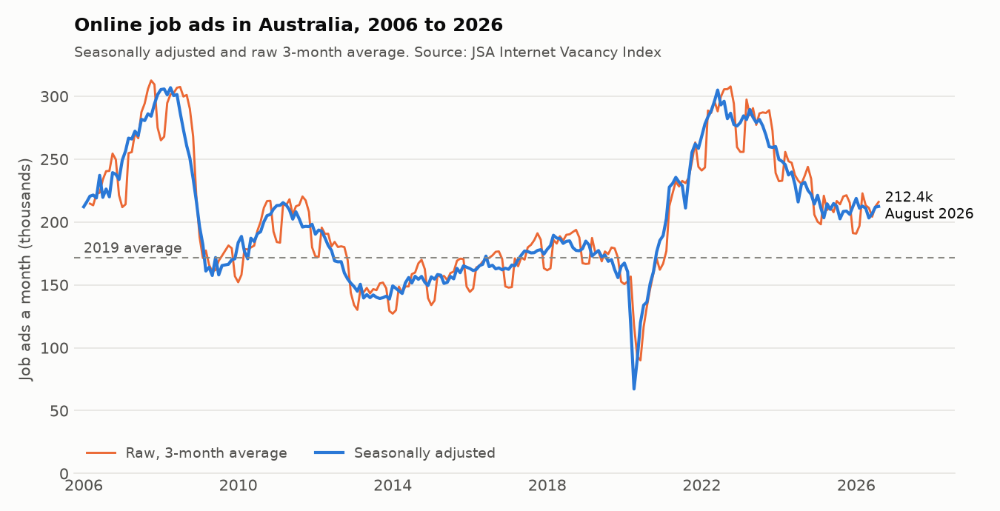
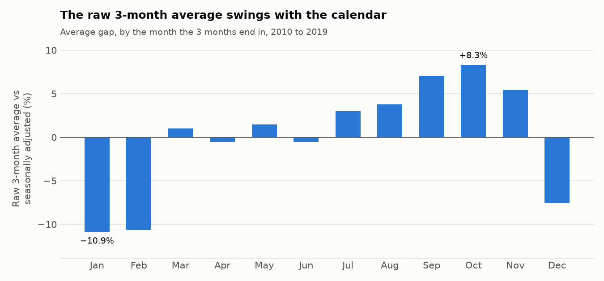
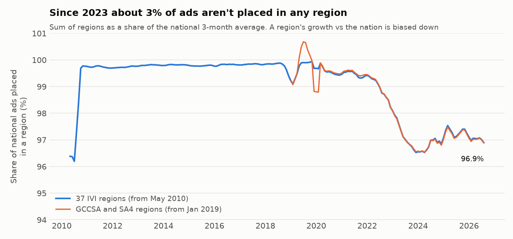
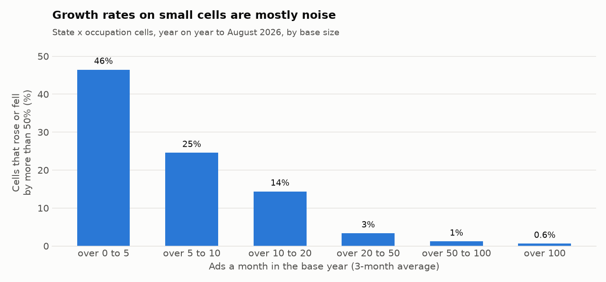

# Part 1: source profile

_Generated by `scripts/profile_source.py` from the snapshot in `data/`. Do not edit by hand._

Source: Jobs and Skills Australia, Internet Vacancy Index, August 2026 release (published 23 September 2026). Licence: CC BY 4.0, (c) Commonwealth of Australia, Jobs and Skills Australia.

## Snapshot

| Table | Rows | Months | Empty values |
|---|---|---|---|
| `data/occupation_state.csv.gz` | 794,826 | 2006-03 to 2026-08 | 15,498 |
| `data/ivi_region.csv.gz` | 413,364 | 2010-05 to 2026-08 | 0 |
| `data/sa4_region.csv.gz` | 262,200 | 2019-01 to 2026-08 | 0 |
| `data/skill_level_state.csv.gz` | 26,784 | 2006-01 to 2026-08 | 0 |

- 351 published 4-digit ANZSCO occupations by state and territory, plus 7 suppressed ones.
- 37 IVI regions and 50 GCCSA/SA4 areas, each split into 48 2-digit occupation groups. 16 of the group codes contain a letter (1A, 1B, 1C, 2A …): they are JSA's custom groups, not standard ANZSCO, so they can't be joined to the 4-digit file by code.

## The latest month, three ways (August 2026)

| Measure | Ads | Use it for |
|---|---|---|
| Seasonally adjusted | 212,401 | JSA's headline; month-on-month change |
| Trend | 212,698 | Direction, smoothed |
| Raw, 3-month average | 215,977 | The only measure for occupations and regions; compare the same month a year apart |

Reconciliation with JSA's release: the seasonally adjusted series changed by 559 ads (+0.3%) from July 2026; the release says "increased by 0.3% (or 560 job advertisements) … to stand at 212,400". It is 23.7% above the 2019 monthly average (the release says "around 25%"); the raw 3-month average is 24.8% above its own 2019 average.

- **Demand is cooling, from a high level.** The 12 months to August 2026 averaged 209,655 ads a month (raw), −3.3% on the 12 months before, but still 21.2% above 2019.
- **It is not a record.** The seasonally adjusted peak was 306,851 in April 2008; the latest month is 30.8% below it.

## Traps in the data, and the rule each one sets

### 1. The raw 3-month average is seasonal

Occupation and regional data come only as raw 3-month averages. Against the seasonally adjusted series (averaged over the same 3 months, 2010 to 2019), the raw figure runs −10.9% in the 3 months ending Jan and +8.3% in the 3 months ending Oct. So the raw figure falls about 18% from Oct to Jan in a normal year: that is the calendar, not the market.

**Rule:** occupation and regional changes are measured year on year on the same month, or as 12-month averages. Never month on month.

| 3 months ending | Raw vs SA (mean) | Lowest year | Highest year |
|---|---|---|---|
| Jan | −10.9% | −13.0% | −7.5% |
| Feb | −10.6% | −13.5% | −8.1% |
| Mar | +1.0% | −2.4% | +4.2% |
| Apr | −0.5% | −1.7% | +1.4% |
| May | +1.5% | +0.4% | +2.5% |
| Jun | −0.5% | −3.5% | +1.9% |
| Jul | +3.0% | +1.2% | +4.7% |
| Aug | +3.8% | +1.7% | +5.9% |
| Sep | +7.1% | +4.9% | +8.9% |
| Oct | +8.3% | +7.2% | +9.5% |
| Nov | +5.4% | +4.9% | +6.4% |
| Dec | −7.6% | −8.8% | −5.1% |

### 2. Seasonally adjusted and trend series don't add up

JSA adjusts each series separately, so the parts of an adjusted series don't sum to its total. The raw 3-month averages do add up across states, but not across occupations (see trap 3).

| Series | Check | Sum of parts | Published total | Gap | Gap % |
|---|---|---|---|---|---|
| seasonally_adjusted | 5 skill levels vs Australia total | 212,839 | 212,401 | 438 | +0.21% |
| seasonally_adjusted | 8 states vs Australia total | 212,657 | 212,401 | 256 | +0.12% |
| trend | 5 skill levels vs Australia total | 212,865 | 212,698 | 167 | +0.08% |
| trend | 8 states vs Australia total | 212,685 | 212,698 | −13 | −0.01% |
| 3-month average | 8 states vs Australia total | 215,977 | 215,977 | 0 | +0.00% |
| 3-month average | published 4-digit occupations vs Australia total | 213,541 | 215,977 | −2,436 | −1.13% |

**Rule:** shares and mixes (an occupation's share of a state, a state's share of the nation) are computed on raw 3-month averages only, never on adjusted series.

### 3. Suppressed occupations hold a growing slice of ads

JSA suppresses 7 occupations as too unreliable: Commissioned Officers (Management), Defence Force Members - Other Ranks, Judicial and Other Legal Professionals, Legislators, Other Hospitality Workers, Other Personal Service Workers, Senior Non-commissioned Defence Force Members. They have no figures at all, so the published occupations add to less than the total. The gap (the suppressed occupations, plus rounding) rose from 0.25% in 2006 to 1.06% in 2026 (January to August).

**Rule:** an occupation's share uses the published total as the denominator, and the report says the suppressed 1.1% is excluded. Totals are never rebuilt by adding occupations.

### 4. Regions miss about 3% of ads, and the gap opened after 2019

The 37 IVI regions held 99.7% to 99.9% of national ads in 2011-2017. Since 2023 they hold 96.5% to 98.1% (96.9% in August 2026); the GCCSA/SA4 file shows the same drop. The rest are ads coded to a state but not a region. So the regions' combined ads rose 21.4% from the 2019 average to August 2026, against 24.8% for the nation: about 3 points of apparent regional lag is coding, not demand.

Each regional file is also rough where it was backcast: the IVI regions held 96.2% to 98.4% of national ads in May 2010 to September 2010 (the series was built in September 2010 and backcast to May), and the GCCSA/SA4 areas swung between 98.8% and 100.7% in 2019 (built in 2024 and backcast to 2019), more than 100% in some months.

The gap also differs by state, so it isn't spread evenly. IVI regions are best-fit labour markets, so a state's regions needn't add to exactly its total (ACT's one region holds slightly more):

| State | Placed in an IVI region |
|---|---|
| NSW | 95.6% |
| VIC | 97.4% |
| QLD | 97.6% |
| SA | 97.8% |
| WA | 97.0% |
| TAS | 92.5% |
| NT | 100.0% |
| ACT | 100.2% |

**Rule:** a region is compared with other regions (or with the sum of regions), never with the national or state total. The two regional geographies are kept apart: they use different boundaries and start in different years. IVI region series are used from October 2010, the first month above 99%, and give the pre-COVID (2019) baseline; the GCCSA/SA4 areas are used for year-on-year views only.

### 5. Most state × occupation cells are small, and small cells are noisy

Of the 2,808 published state × occupation cells in August 2026, 1,631 (58%) have 20 or fewer ads a month. Year on year, 46% of cells with more than 0 and up to 5 ads moved by more than 50%, against 3% of cells with 20 to 50 and 0.6% of cells over 100. The pattern is the same in 2018-19, before COVID.

Without a floor, a "fastest growing" list is all noise: the top 10 year-on-year risers all started from 0.67 ads a month or fewer, led by SA Film, Television, Radio and Stage Directors (0.33 to 6.00, +1700%). With the floor, the top riser is QLD Midwives (24.67 to 49.33, +100%), a change big enough to look into.

**Rule:** growth rankings only include cells averaging more than 20 ads a month in the base period; smaller cells are shown as counts, not percentages. State × occupation results are shown with their base size.

| Ads a month, August 2026 | Cells | Share |
|---|---|---|
| 0 | 204 | 7.3% |
| over 0 to 5 | 758 | 27.0% |
| over 5 to 10 | 306 | 10.9% |
| over 10 to 20 | 363 | 12.9% |
| over 20 to 50 | 440 | 15.7% |
| over 50 to 100 | 243 | 8.7% |
| over 100 | 494 | 17.6% |

| Years | Base (ads a month) | Cells | Moved more than ±50% | Middle 50% of changes spans |
|---|---|---|---|---|
| 2025-08 to 2026-08 | over 0 to 5 | 762 | 46.5% | 100 pts |
| 2025-08 to 2026-08 | over 5 to 10 | 338 | 24.6% | 63 pts |
| 2025-08 to 2026-08 | over 10 to 20 | 334 | 14.4% | 46 pts |
| 2025-08 to 2026-08 | over 20 to 50 | 447 | 3.4% | 30 pts |
| 2025-08 to 2026-08 | over 50 to 100 | 252 | 1.2% | 23 pts |
| 2025-08 to 2026-08 | over 100 | 488 | 0.6% | 18 pts |
| 2018-08 to 2019-08 | over 0 to 5 | 901 | 50.3% | 100 pts |
| 2018-08 to 2019-08 | over 5 to 10 | 336 | 17.6% | 48 pts |
| 2018-08 to 2019-08 | over 10 to 20 | 350 | 10.9% | 45 pts |
| 2018-08 to 2019-08 | over 20 to 50 | 363 | 5.0% | 31 pts |
| 2018-08 to 2019-08 | over 50 to 100 | 218 | 1.8% | 22 pts |
| 2018-08 to 2019-08 | over 100 | 411 | 0.7% | 18 pts |

### 6. Job ads are not jobs

From JSA's methodology: the IVI counts new ads on SEEK, CareerOne and Workforce Australia only, after removing duplicates. It misses jobs filled by word of mouth, employer sites and social media, counts a multi-position ad once, and leans towards higher-skilled roles.

**Rule:** results are described as *online job ads* (a demand signal), never as vacancies or hires.
